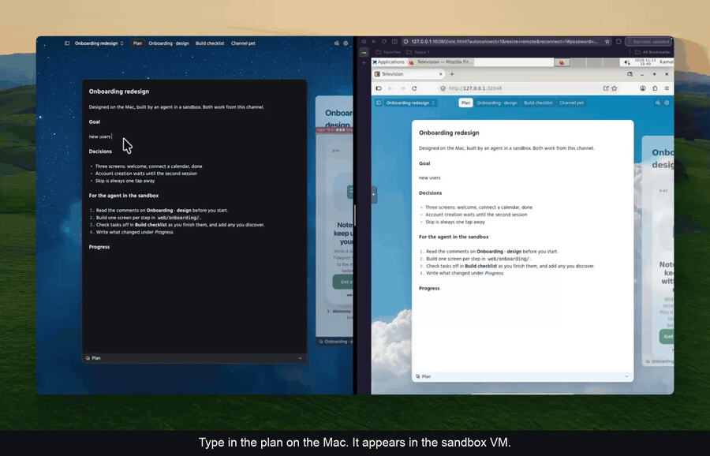
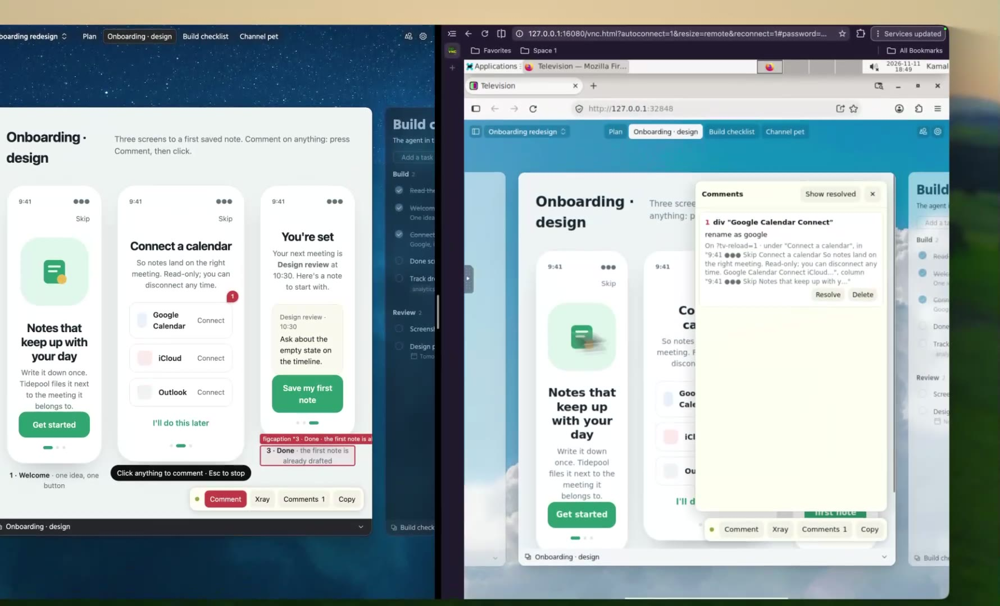
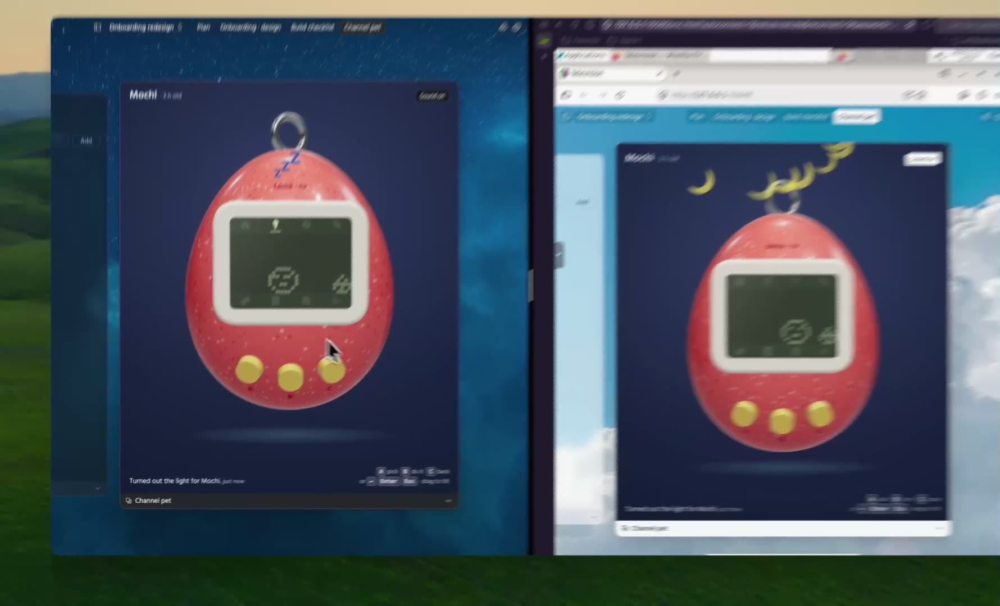

# tv-sync

Sync Television channels across your machines and with people you trust. Design on one machine, carry on from a laptop or an Amp orb (offline too), and pick it up later anywhere, with every comment and edit merged.

Every machine keeps a full copy of the channels it syncs. Changes travel through a small relay on Cloudflare and merge with [Loro](https://loro.dev) CRDTs, so no machine has to stay on, and none needs a network path to another.



Left: Television on a Mac. Right: Television in a sandbox VM. Each runs tv-sync, and the two meet only through the relay.

<p>
  
  
</p>

## Install

You need Television (`tv`) and [Rust](https://rustup.rs). This installs tv-sync, plus a skill that teaches your coding agents how to share channels and what syncs. Run it again to update both.

```bash
curl -fsSL https://raw.githubusercontent.com/Kamalnrf/tv-sync/main/install.sh | sh
```

It runs `cargo install --locked --git https://github.com/Kamalnrf/tv-sync tv-sync`, then `npx skills add Kamalnrf/tv-sync --skill tv-sync --global`.

## Share a channel

A space is a group of machines and people that sync a set of channels. Everyone in a space sees every channel shared into it.

On the machine that has the channel:

```bash
tv-sync space create Games
tv-sync share "Whimsical games"
tv-sync invite            # one use, valid 15 minutes
```

On the other machine:

```bash
tv-sync join tvs1:…
```

These commands start the background sync themselves. `tv-sync status` shows whether it's running and what each space holds, `tv-sync start` restarts it after a reboot, and `tv-sync stop` stops it. `tv-sync --help` lists the rest.

## Run your own relay

`space create` uses a public relay by default. To keep your spaces on your own Cloudflare account instead, deploy the relay there: a Worker, one Durable Object per space, and an R2 bucket for file contents.

```bash
cd relay && npm install
npm run login     # once: connects the `tv-sync` Alchemy profile to your Cloudflare account
npm run deploy    # prints the relay's URL
```

Then create spaces with `tv-sync space create <name> --relay <url>`, or set `TV_SYNC_RELAY`. Machines that join get the relay from the invite. `npm run dev` runs the same relay on this machine, with no account needed.

Anyone can create a space on a relay, at most 10 a minute from one address. A space stays private all the same: its ID can't be guessed, and only devices that joined with an invite can read or write it.

## Development

```bash
cargo test
```
